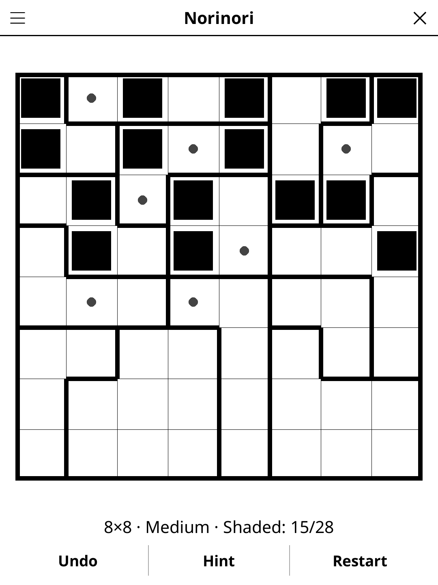

# norinori.koplugin

A Norinori puzzle plugin for [KOReader](https://github.com/koreader/koreader).

## Screenshot

## Rules

Shade cells so that every outlined region holds exactly two shaded cells and
every shaded cell touches exactly one other shaded cell side by side: the
shaded cells form dominoes, never longer lines or blobs. A domino may lie in
one region or straddle two, giving one cell to each. Dominoes may touch
diagonally, never side by side.

## Features

- **Generated puzzles, one solution each** — every grid is checked by an
  exhaustive solver before you see it, and can be solved by logic alone
- **Three sizes** — 6×6, 8×8, 10×10
- **Three difficulty levels**, graded by the hardest technique the solver
  needs: easy falls to counting and domino rules, medium needs case analysis
  on a region, hard needs a one-step "what if" trial
- **Live rule check** — a shaded cell that already breaks a rule is crossed out
- **Hint** — two taps: the first says which cell is about to give, the second
  acts on it. A cell that contradicts the solution is always reported before a
  fresh one is revealed
- **Undo, Restart, Show solution, timer**, and auto-save of the game in
  progress

## Installation

1. Download `norinori.koplugin.zip` from the [latest release](../../releases/latest).
2. Extract into the `plugins/` folder of your KOReader data directory.
3. Restart KOReader.
4. Open the menu → **Tools** → **Norinori**.

## Controls

| Action | How |
|--------|-----|
| Shade / dot / blank | Tap a cell (cycles) |
| Blank a cell | Hold it |
| Undo, hint, clear the grid | **Undo**, **Hint**, **Restart** |
| New game, size, difficulty, solution, rules | Menu (top left) |

## How the puzzles are made

The generator plants a dense set of non-touching dominoes (the densest of
four tries: denser means smaller regions, and uniqueness comes easier), grows
one proto-region per shaded cell and pairs them into regions of two shaded
cells, so the planted shading is a valid answer. It then reshapes the regions
until it is the only answer: while the solution counter still finds a rival, a
cell the rival shades (and the planted answer leaves empty) moves into a
neighbouring region, which breaks the rival and keeps the planted answer
valid. Finally it reshapes toward the requested difficulty, checked by the
logical solver.

Generation averages 0.005–0.07 s on a desktop and took at most 0.4 s over 100
seeds at every size and level, 0.2 s at 10×10 (6×6 hard is the slowest: a
grid that small seldom needs a trial). A device several times slower shows a
progress bar when it takes a moment. Every limit in the generator counts moves
or search steps, never time, so the same seed builds the same grid on every
device — which the Daily Challenge relies on.

## License

GPL-3.0 — see [LICENSE](LICENSE).
